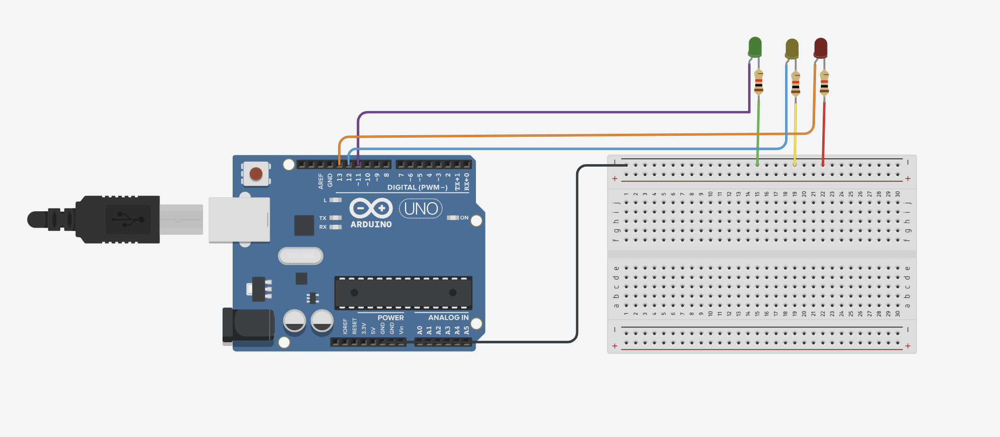
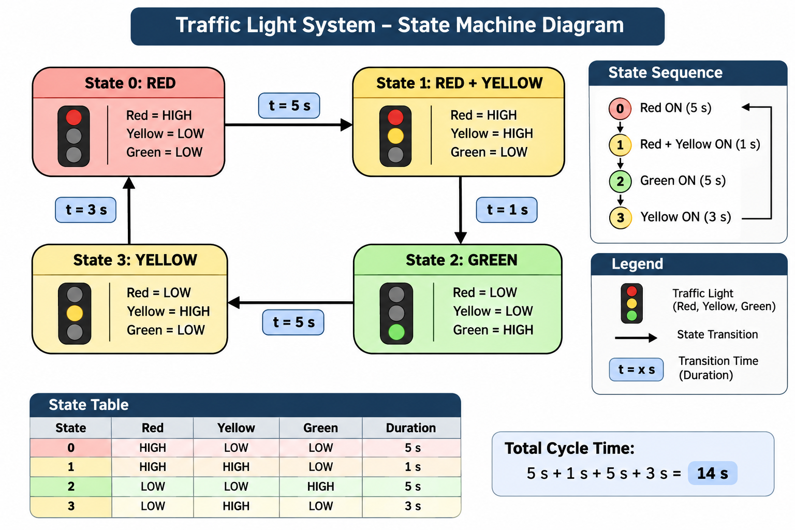
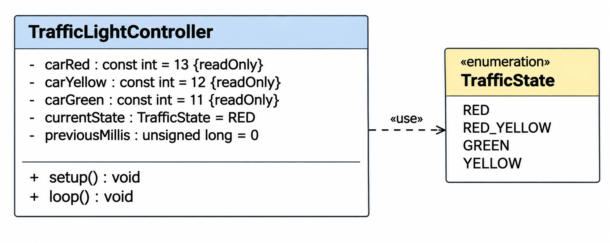

# Task 1 – Arduino Traffic Light Control System

## 📌 Project Overview

This project demonstrates the design and implementation of a basic traffic light control system using an **Arduino Uno**.

The system uses three LEDs (Red, Yellow, and Green) to simulate a traffic light. The project focuses on digital output control, LED sequencing, timing, and basic embedded system design.

The project also includes a circuit diagram, a state machine diagram, and a UML class diagram.

## 🎯 Project Objectives

- Understand Arduino Uno digital output pins.
- Control LEDs using `digitalWrite()`.
- Implement traffic light sequences.
- Understand timing using `delay()`.
- Design a traffic light state machine.
- Create a UML class diagram.
- Understand basic embedded system hardware connections.

## 🛠️ Hardware Components

| Component | Quantity |
|---|---|
| Arduino Uno | 1 |
| Breadboard | 1 |
| Red LED | 1 |
| Yellow LED | 1 |
| Green LED | 1 |
| Current-limiting resistors | 3 |
| Jumper wires | As required |
| USB cable | 1 |

## 🔌 Pin Configuration

| LED | Arduino Pin |
|---|---|
| Red | 13 |
| Yellow | 12 |
| Green | 11 |

## 📷 Scenario 1 – Basic Traffic Light Circuit

The circuit consists of three LEDs connected to the Arduino Uno through current-limiting resistors.

Each LED is controlled independently using a digital output pin.

## 🔄 Traffic Light State Diagram

The state machine describes four operating states.

| State | Active LEDs | Duration |
|---|---|---|
| State 0 | Red | 5 seconds |
| State 1 | Red + Yellow | 1 second |
| State 2 | Green | 5 seconds |
| State 3 | Yellow | 3 seconds |

### State Transition

Red → Red + Yellow → Green → Yellow → Red

The sequence repeats continuously.

## 📊 UML Class Diagram

The UML class diagram illustrates the object-oriented design of the traffic light system.

### TrafficLightController
Responsible for managing the traffic light states and transition timing.

### Light
Represents an LED and contains its color, Arduino pin number, and ON/OFF status.

### Resistor
Represents the current-limiting resistor connected to an LED.

### Color Enumeration
Defines three possible LED colors:
- RED
- YELLOW
- GREEN

## 💻 Arduino Programming

The traffic light system can be programmed using Arduino C/C++.

The main Arduino functions used for basic LED control are:

- `pinMode()` – Configures digital pins as outputs.
- `digitalWrite()` – Turns LEDs ON or OFF.
- `delay()` – Controls the duration of each traffic light phase.
- `setup()` – Initializes the Arduino configuration.
- `loop()` – Executes the program continuously.

## 📚 Learning Outcomes

Through this task, I learned:

- How to connect LEDs to an Arduino Uno.
- How to configure digital output pins.
- How to control LEDs using Arduino programming.
- How traffic light sequences work.
- How to represent system behavior using a state machine.
- How to model a system using a UML class diagram.
- How to document an embedded systems project on GitHub.

## 🚀 Future Improvements

- Implement non-blocking timing using `millis()`.
- Introduce pedestrian crossing functionality.
- Add push-button control.
- Implement an advanced finite state machine (FSM).

## 🧰 Development Tools

- Arduino Uno
- Arduino IDE
- Circuit design software
- draw.io for diagrams
- GitHub for version control and documentation

---

**Project:** Embedded Systems – Task 1

**System:** Three-LED Traffic Light Controller

**Purpose:** Learning Arduino programming, digital output control, and embedded system design.
